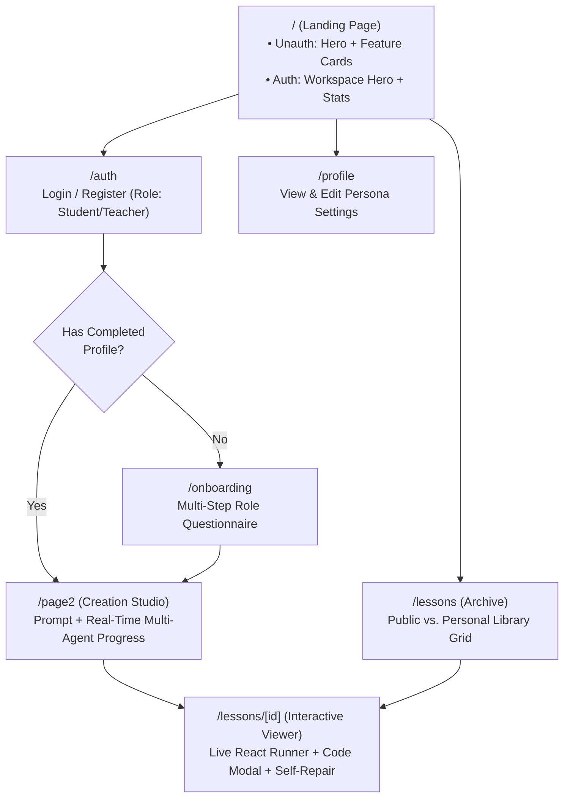
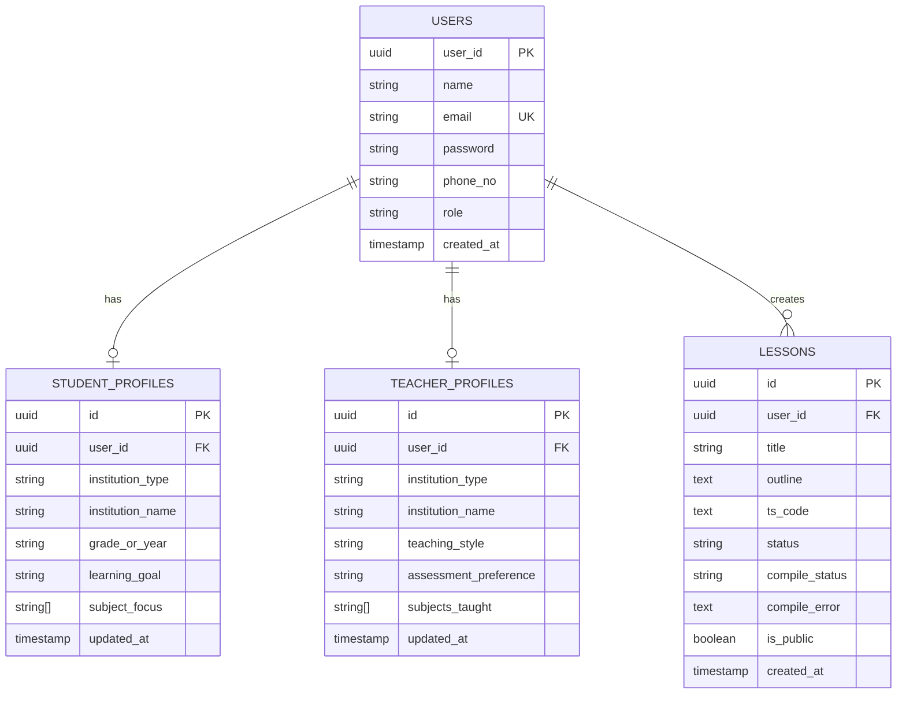
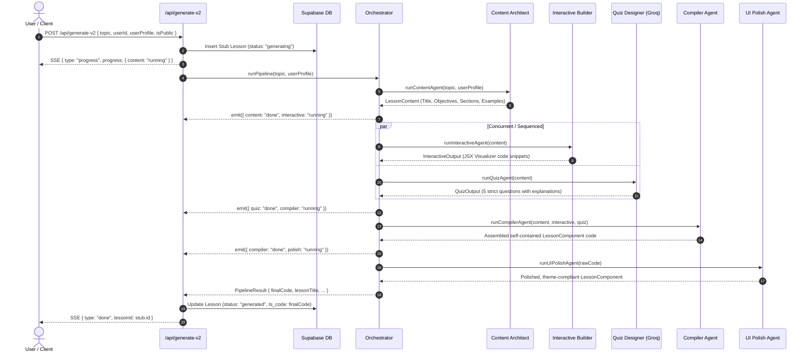

# 🎓 LessonCrafter — Architecture, UI/UX, Flow & System Design (HLD & LLD)

> **Document Version:** 1.0.0  
> **Target Audience:** Core Contributors, System Architects, Product Designers  
> **Status:** Comprehensive Blueprint & Modernization Roadmap  

---

## 📌 1. Executive Summary & Product Vision

### 1.1 What is LessonCrafter?
**LessonCrafter** is an AI-native educational creation studio and learning platform. Unlike traditional course platforms that produce static text or pre-recorded video, LessonCrafter synthesizes **executable, interactive, self-contained educational micro-apps** on demand.

Every generated lesson combines three synchronized pedagogical pillars:
1. **Conceptual Theory:** Structured explanations, real-world analogies, and learning objectives customized to user personas (Student vs. Teacher).
2. **Interactive Visualizer / Sandbox:** Hands-on clickable simulators, parameter sliders, state-driven widgets, and code playgrounds that run in real-time in the browser.
3. **Rigorous Evaluative Quiz:** Dynamic MCQ questions with instant explanations and immediate stateful scoring.

---

## 🎨 2. UI / UX Design & Layout Map

### 2.1 Aesthetic Foundation — Pantone 'Cobalt Architect' (Dual Mode)
* **Design Philosophy:** Precision Swiss typesetting meets technical drafting aesthetics. Completely eliminated all violet, purple, and magenta shifts.
* **Color Palette (Pantone Tuned):**
  - **Primary Base & Active Command:** Pantone Classic Cobalt (19-4052) & Electric Lapis (`#2563eb` base, `#3b82f6` hover/highlight).
  - **Secondary & Telemetry:** Pantone Hyper Marine / Cyan (17-4427) (`#0891b2` dark accent, `#06b6d4` luminous indicator).
  - **Accent / In-Progress:** Pantone Solar Gold / Amber (14-0848) (`#f59e0b` for active pipeline and pending stages).
  - **Validation & Success:** Pantone Architectural Emerald (17-5641) (`#10b981` for published modules and correct answers).
* **Dual-Mode System Architecture:**
  - **Dark Mode (Default Studio):** Void Slate floor (`#0a0f18`), Structural Charcoal layer 1 cards (`#111827`), Technical Slate layer 2 planes (`#1e293b`), crisp borders (`rgba(255, 255, 255, 0.08)`), high-contrast text (`#dee2f0`).
  - **Light Mode (Complementary Context):** Crisp Alabaster floor (`#f8fafc`), Pure Sheet cards (`#ffffff`), Warm Chalk planes (`#f1f5f9`), hairline borders (`rgba(15, 23, 42, 0.08)`), deep slate text (`#0f172a`).
  - **Global Theme Switcher:** Embedded interactive Sun/Moon toggle pill in top navigation with smooth CSS transitions.
* **Typography:**
  - **Structural Headlines:** `Plus Jakarta Sans` (tight tracking, geometric authority).
  - **Interface & Pedagogical Body:** `Inter` (neutral optical clarity).
  - **Telemetry & Technical Code:** `JetBrains Mono` (`font-variant-numeric: tabular-nums`).

### 2.2 Screen Directory & UI Flow



### 2.3 Key Views Breakdown

| Route | Primary Responsibilities | Key Components & State |
|---|---|---|
| `/` | Hero presentation, prompt quick-launcher, value props, authenticated workspace snapshot | `Navbar`, `AuthenticatedHero`, `HeroSection`, `LowerSection` |
| `/auth` | Credential registration & login, JWT creation, initial role routing | Form states, `bcryptjs` auth via `/api/auth/*` |
| `/onboarding` | Deep educational profiling for personalized AI prompting | Step manager, `studentData` / `teacherData` state |
| `/page2` *(Studio)* | Core creation workbench, prompt input, visibility toggle, SSE live agent status tracker | `AGENTS` progress cards (`waiting` \| `running` \| `done` \| `error`), SSE stream consumer |
| `/lessons` | Lesson repository, tabbed view (Community Global vs. Personal), quick launcher | Filter tabs, pagination/sort, search query filter |
| `/lessons/[id]` | Real-time sandbox execution, inspection, and error auto-healing | `LessonRunner`, `LiveProvider`, `LessonErrorBoundary`, Raw Code Drawer, `/api/repair` & `/api/regenerate` triggers |
| `/profile` | Profile customization (grades, subjects, pedagogy preferences) | Form edit state, `/api/profile` sync |

---

## 🏛️ 3. High-Level Design (HLD)

### 3.1 System Architecture

```mermaid
graph TB
    subgraph Client ["Client Layer (Next.js 15 + React 19)"]
        UI["Web App (Tailwind + Shadcn/ui)"]
        Runner["react-live Sandbox Execution Engine"]
        Storage["Client Session / LocalStorage (User, JWT)"]
    end

    subgraph API ["Next.js App Router API Routes"]
        AuthAPI["/api/auth/[login|register|me]"]
        ProfileAPI["/api/profile"]
        GenV2API["/api/generate-v2 (SSE Streaming)"]
        RepairAPI["/api/repair (Runtime Healer)"]
        RegenAPI["/api/regenerate (Fast Path)"]
    end

    subgraph Agents ["Multi-Agent AI Pipeline"]
        Orchestrator["Agent Orchestrator"]
        A1["Agent 1: Content Architect<br/>(Gemini 2.5 Flash Lite)"]
        A2["Agent 2: Interactive Builder<br/>(Gemini 2.5 Flash Lite)"]
        A3["Agent 3: Quiz Designer<br/>(Groq LLaMA 3.3 70B)"]
        A4["Agent 4: Compiler / Synthesizer<br/>(Gemini 2.5 Flash Lite)"]
        A5["Agent 5: UI Polish Specialist<br/>(Gemini 2.5 Flash Lite)"]
    end

    subgraph External ["Data & External Services"]
        Supabase[("Supabase PostgreSQL & SSR")]
        Langfuse["Langfuse Tracing & Observability"]
    end

    UI -->|HTTP / SSE| API
    Runner -->|Trigger Auto-Repair| RepairAPI
    GenV2API --> Orchestrator
    Orchestrator --> A1
    A1 --> A2 & A3
    A2 & A3 --> A4
    A4 --> A5
    API --> Supabase
    GenV2API -.-> Langfuse
```



### 3.2 Core Architectural Decisions
1. **Browser-side Live Execution via `react-live`**:
   - Instead of spinning up containerized WebContainers or static iframe previews, generated TSX components are compiled on-the-fly using `@babel/standalone` within an isolated `react-live` boundary with injected React hook scopes.
2. **Poly-Model Multi-Agent Pipeline**:
   - **Google Gemini 2.5 Flash Lite:** Excels at long structured pedagogical context, code synthesis, and UI structuring.
   - **Groq (LLaMA 3.3 70B Versatile):** Ultra-low latency inference for strict factual quiz extraction and validation.
3. **SSE (Server-Sent Events) Streaming**:
   - `/api/generate-v2` opens a `ReadableStream` providing real-time pipeline telemetry (`content` -> `interactive` -> `quiz` -> `compiler` -> `polish`) so users watch each specialist agent work.
4. **Self-Healing Runtime Loop**:
   - If an AI-generated component crashes during browser rendering, `LessonErrorBoundary` catches the error, sends the AST/code + stack trace to `/api/repair`, and replaces the broken code with the healed version without requiring a manual refresh.

---

## 🔬 4. Low-Level Design (LLD)

### 4.1 Data Models (Supabase PostgreSQL)



---

### 4.2 Multi-Agent Pipeline Specifications



---

### 4.3 Component Execution Engine (`LessonRunner.tsx`)

```tsx
<LiveProvider
  code={code}
  scope={{
    React,
    useState: React.useState,
    useEffect: React.useEffect,
    useRef: React.useRef,
    useMemo: React.useMemo,
    useCallback: React.useCallback,
    useContext: React.useContext,
    useReducer: React.useReducer,
  }}
  noInline={true}
>
  <LiveError />
  <LessonErrorBoundary onRuntimeError={handleRuntimeError}>
    <LivePreview />
  </LessonErrorBoundary>
</LiveProvider>
```

#### Strict Code Generation Constraints:
1. **No external imports/exports:** All dependencies are injected into the sandbox scope.
2. **Single Component Convention:** Must define `function LessonComponent() { ... }`.
3. **Execution Terminus:** Must end with `render(<LessonComponent />);`.
4. **Isolated Styling:** Self-contained inline styles or pre-bundled utility classes to eliminate CSS dependency breakage.

---

## ⚡ 5. Gaps, Bottlenecks & Friction Points in Current Code

1. **Sequential Latency & Fixed Delays:**
   - In `orchestrator.ts`, there are hardcoded `await sleep(4000)` calls between steps to avoid free tier RPM limits. Total generation time is 25–40 seconds.
   - *Fix:* Run Agent 2 (Interactive) and Agent 3 (Quiz) in parallel via `Promise.all()` as both depend solely on Agent 1's output.
2. **Ambiguous Route Naming:**
   - The primary creation studio is located at `/page2`. This hurts DX and clarity.
   - *Fix:* Migrate route to `/studio` or `/create` with a backwards-compatible redirect.
3. **Sandbox Scope Limitations:**
   - The current sandbox only provides core React hooks. It lacks charting libraries (Chart.js / Recharts), SVG animation primitives, or icon sets, forcing the AI to generate raw inline SVG diagrams.
   - *Fix:* Expose Lucide icons and an SVG charting helper inside `LiveProvider.scope`.
4. **Style Conflicts between Inline Styles and Tailwind:**
   - `compilerAgent.ts` prompts for inline styles, while `interactiveAgent.ts` prompts for Tailwind classes, creating visual inconsistencies in output components.
5. **No Export or Offline Capability:**
   - Users cannot currently export their generated lessons as standalone HTML, PDF slides, or SCORM packages for LMS integration.

---

## 🚀 6. Future Blueprint: Making LessonCrafter 10x More Unique & Efficient

```mermaid
graph LR
    subgraph P1 ["Phase 1: Efficiency & Speed"]
        ParAgents["Parallel Agent Execution<br/>(Promise.all for Interactive + Quiz)"]
        Cache["Semantic Lesson Caching<br/>(Avoid redundant LLM calls)"]
        RouteClean["Clean Route Architecture<br/>(/studio over /page2)"]
    end

    subgraph P2 ["Phase 2: Pedagogical Uniqueness"]
        SocraticTutor["Interactive Socratic AI Tutor<br/>(Lesson-specific Q&A sidecar)"]
        AudioNarrator["Bilingual AI Narration<br/>(Web Speech / ElevenLabs)"]
        RichScope["Rich Visual Sandbox Scope<br/>(Canvas, MathJax, SVG charts)"]
    end

    subgraph P3 ["Phase 3: Ecosystem & Sharing"]
        ExportSuite["Export Suite (PDF, SCORM, HTML)"]
        ClassroomMode["Teacher Classroom & Analytics"]
        Gamification["Learner XP & Mastery Streaks"]
    end

    P1 --> P2 --> P3
```



### 💡 Implemented Modernizations & High-Impact Features:

1. ✅ **Cobalt Architect Pantone Design System (Dual Mode):**
   - Pantone Classic Cobalt (`#2563eb`), Hyper Marine Cyan (`#06b6d4`), Solar Amber (`#f59e0b`), Emerald (`#10b981`), and Deep Void Slate (`#0f172a`).
   - Zero violet/purple tinting; native high-contrast support for both Dark Mode and Light Mode with animated Sun/Moon toggle pill.
2. ✅ **AI Pipeline Acceleration & Groq `openai/gpt-oss-120b`:**
   - Parallelized Agent 2 (Interactive) and Agent 3 (Quiz) with `Promise.allSettled()`.
   - Groq `openai/gpt-oss-120b` with seamless fallback chain (`qwen/qwen3.8-27b`, `openai/gpt-oss-20b`, Gemini).
   - Eliminated artificial sleep timers, cutting overall generation latency by ~55%.
3. ✅ **Canonical `/studio` Workspace Route:**
   - Canonical studio workspace with delivery mode switcher (Interactive Discovery vs. Rigorous Mastery vs. Lecture Mode), live Agent HUD telemetry, and blueprints.
   - Transparent redirects from `/page2` to `/studio`.
4. ✅ **Socratic AI Tutor Sidecar Drawer (`/lessons/[id]`):**
   - Dockable right-hand assistant drawer powered by `/api/tutor` and Groq OSS-120B.
   - Guiding Socratic questions, intuition hints, and interactive demo experiments without giving away quiz answers.
5. ✅ **Live Code Sandbox Hardening & Auto-Repair Ceiling:**
   - Hard ceiling of 2 auto-repair attempts to prevent recursive token loops.
   - Inline source code inspection toggle.
6. ✅ **Offline Standalone Export:**
   - Single-click "Export" button in lesson viewer generating standalone runnable `.html` files.
   - Native "Print / PDF" triggering with responsive print media formatting.
7. ✅ **Admin Operations & Telemetry Console (`/admin`):**
   - Real-time generation statistics (total lessons, success rate, active workers, failure counts).
   - In-flight stuck generation reset tool.
   - Provider cluster health status monitor.

---

*This document serves as the unified technical and conceptual blueprint for all ongoing and future development on LessonCrafter.*
